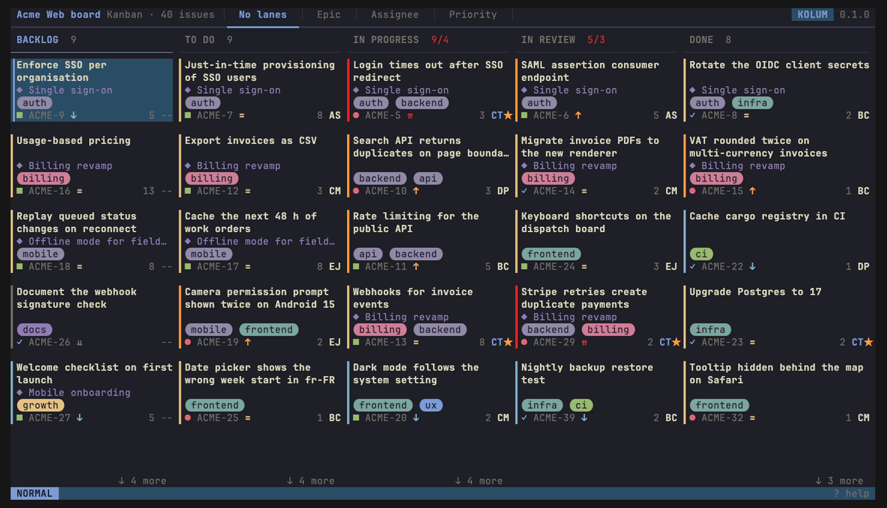

<div align="center">


<h1>kolum</h1>

<p align="center">
  <a href="CHANGELOG.md">Changelog</a>
  ·
  <a href="#install">Install</a>
  ·
  <a href="#keys">Keys</a>
  ·
  <a href="#configuration">Configuration</a>
  ·
  <a href="CONTRIBUTING.md">Contributing</a>
</p>

[](https://github.com/ColinTenaguillo/kolum/actions/workflows/ci.yml)
[](https://github.com/ColinTenaguillo/kolum/releases/latest)
[](LICENSE)
[](https://ratatui.rs/)

### A kanban board for your ticket tracker, in the terminal

Jira and GitHub Projects, with vim keys, a fuzzy picker
and issues laid out like the web app.

</div>

<p align="center">
  
</p>

## Features

- **Jira Cloud and GitHub Projects**, each as a profile
- A board that shows what the web board shows, on screen at once from a
  per-profile cache and kept in sync in the background
- Vim keys throughout: motions, counts (`3j`), sequences (`gg`), a leader,
  and every binding rebindable by name
- A Telescope-style picker for issues, boards, people, themes and commands,
  with a preview and remote search (raw JQL with `!`)
- Move, assign, comment, edit and clone, on screen before the tracker answers
  and undone with its own message if it refuses
- Edit titles, descriptions and comments as Markdown in `$EDITOR`, and any
  other field its own way
- Visual mode for grouped actions, swimlanes by epic, assignee or priority
- Avatars and pictures through the terminal's image protocol (kitty, Ghostty,
  WezTerm, iTerm2, foot), half blocks elsewhere
- Six themes, your own theme files, and any colour by hand

## Try it

No account needed: `--demo` opens a board of 40 realistic issues from an
in-memory provider.

```sh
kolum --demo
```

Press `?` for every key, then `/` to keep only the lines that hold what you
type.

## Install

Runs on macOS and Linux (arm64, x86_64).

### Homebrew

```sh
brew install ColinTenaguillo/tap/kolum
```

### Installer script

Downloads the binary for your platform into `~/.cargo/bin`.

```sh
curl --proto '=https' --tlsv1.2 -LsSf https://github.com/ColinTenaguillo/kolum/releases/latest/download/kolum-installer.sh | sh
```

### Nix

```sh
nix run github:ColinTenaguillo/kolum
```

### Prebuilt archive

Each [release](https://github.com/ColinTenaguillo/kolum/releases/latest)
carries an archive per platform and its SHA-256. Unpack it and put `kolum` on
your `PATH`.

### From source

Rust 1.88 or later:

```sh
cargo install --locked --git https://github.com/ColinTenaguillo/kolum kolum
```

## Getting started

Run without a profile, kolum asks a few questions (Jira URL, e-mail, how to
get the token, the board) and writes the profile to `config.toml`. A token
kept in the file makes the file readable by you alone.

### Jira

Cloud is read and written through REST v3 and Agile 1.0. Use your e-mail and an
[API token](https://id.atlassian.com/manage-profile/security/api-tokens):

```toml
default_profile = "work"

[profiles.work]
provider = "jira"
base_url = "https://acme.atlassian.net"
email = "me@acme.com"
token_cmd = "pass show jira/acme"   # or token = "...", or $KOLUM_TOKEN
board = 42                          # else the first board listed
```

The estimate, sprint and epic-link fields are found from `/field` by schema and
name. If they are wrong, force them:

```toml
[profiles.work.fields]
estimate = "customfield_10016"
sprint = "customfield_10020"
epic_link = "customfield_10014"
```

### GitHub Projects

A project (ProjectV2) is a board and the options of its Status field are the
columns. Issues, pull requests and draft issues are its cards, keyed `repo#42`.

```toml
[profiles.oss]
provider = "github"
project = "octo-org/12"             # owner/number, a user's or an org's
token_cmd = "gh auth token"
# status_field = "Status"           # the single-select field used as columns
```

`gh auth token` works once its token has the project scopes:
`gh auth refresh -s read:project,project`.

Priority, an estimate (Estimate, Size or Points) and an iteration are read from
project fields of those names; other single-select and number fields show in
the detail. Remote search uses GitHub's syntax inside the project, `!` for raw
queries.

## Keys

The defaults follow vim. Counts work on motions (`3j`, `5G`), sequences wait
`timeoutlen` for their next key, and a popup lists what can follow a prefix.
`?` shows them all, `Space p` runs any of them by name.

### Moving around

| Keys | Does |
|---|---|
| `h` `j` `k` `l` | Previous or next column, card |
| `gg` `G` · `0` `$` | First or last card · first or last column |
| `Ctrl-d` `Ctrl-u` | Half a page |
| `Enter` `gd` | Open the issue |
| `gp` | Open its parent (the epic) |
| `Ctrl-o` · `Ctrl-i` | Back to the issue left or closed before, where you left it · forward again (`Ctrl-i` is the key `Tab` sends) |
| `gt` `gT` | In an issue: next or previous activity tab (comments, history, all) |
| `s` · `ze` | Cycle swimlanes · hide or show empty columns; both remembered |
| `r` | Reload the board from the provider |
| `q` `Esc` | Close the view; `q` on the board quits |

### Finding

| Keys | Does |
|---|---|
| `/` then `n` `N` | Filter the board as you type, step through matches |
| `/` then `n` `N`, in an issue | Search its text, highlighted, and jump from match to match; `Esc` clears, a second `Esc` closes |
| Paste a link or a key | Open that issue, from the board or an issue: a Jira or GitHub link, `PROJ-123`, `repo#42`; in a picker, the link is typed as its key |
| `Space f` | Find an issue, fuzzy |
| `Space F` | Search the provider; `!` starts raw JQL, a key or a number finds that issue |
| `Space b` | Switch board |
| `Space u` | Show the cards of one or several people |
| `Space p` | Command palette: every action and its keys |
| `Space t` | Themes, previewed as you move |
| `Space '` | Reopen the last picker as you left it |

The filter and the pickers take the same prefixes: `@me` `@name` `#bug`
`s:review` `l:backend` `e:PROJ-10` `sp:14`. The filter applied is remembered;
`Esc` clears it.

In a picker you type in insert mode; `Esc` goes to normal mode, where `j` `k`
move and `q` closes. `Ctrl-n` `Ctrl-p` move in either mode, `Tab` marks several
issues for one action, `Ctrl-Space` switches between local and remote,
`Ctrl-d` `Ctrl-u` scroll the preview, `Up` recalls past searches.

### Changing issues

| Keys | Does |
|---|---|
| `H` `L` · `t` | Move the card a column left or right · pick a transition |
| `J` `K` | Move the card down or up its column, within its swimlane |
| `Space a` `Space A` | Assign · assign to me |
| `i` · `e` | Comment · edit the title and description, in `$EDITOR` as Markdown |
| `E` (issue view) | Edit any field the issue lets you set, each its own way |
| `c` · `C` | Create an issue in `$EDITOR` · clone the card |
| `v` | Visual mode: a range of cards for one action (`t` `H` `L` `Space a` `yy` `C`) |

### The rest

| Keys | Does |
|---|---|
| `yy` `yu` `o` | Copy the key, copy the URL, open in the browser |
| `gi` (issue view) | The issue's pictures, full screen: `h` `l` the one before or after, `o` in the browser, `yu` its URL, `q` back |
| `:` | `:theme <name>`, `:board [id]`, `:jql [query]`, `:help`, `:refresh`, `:q`, and every action by its name, proposed as you type |

## Configuration

`~/.config/kolum/config.toml` (or `$XDG_CONFIG_HOME/kolum`). Nothing is
required for `--demo`. Every problem in the file (an unknown setting, an
unknown action, a key that does not parse, one key spelt twice) is listed in a
box at start, and the rest of the file still applies.

```toml
[ui]
theme = "kanagawa"                # dark light kanagawa catppuccin tokyonight gruvbox
images = "auto"                   # auto, halfblocks, off: avatars in the issue view
hide_empty_columns = true
sync_secs = 30                    # what changed, every 30 s and 5 s after each change of yours; 0: only on r
# filter = "@me"                  # the board filter at the first start; then the last one applied
card_fields = ["type", "key", "priority", "labels", "epic", "estimate", "assignee"]
detail_fields = ["status", "assignee", "reporter", "priority", "sprint", "epic", "labels", "customfield_10016"]
# detail_sections = ["Bug report"]  # rich text fields under the description

[picker]
layout = "horizontal"             # horizontal vertical no_preview
```

With `detail_fields` unset, the issue view shows the fields Jira Cloud's web
view shows, in its order, and elsewhere every field the issue fills.

### Keys

Any binding moves by action name, per context: `global`, `board`, `visual`,
`detail`, `viewer`, `help`, `picker`, `picker_insert` or `command`. Bindings with a modifier also
work while typing in a picker. `Space p` lists the names.

```toml
[keys]
leader = "<Space>"
timeoutlen_ms = 600

[keys.board]
"J" = "move_card_right"
"L" = "none"                      # unbinds a default

[keys.picker]
"<C-t>" = "transition"
```

### Themes

```toml
[theme.overrides]                 # any token, flat or nested
accent = "#7e9cd8"
"status.done" = "green"
label_palette = ["#7e9cd8", "#98bb6c", "#957fb8"]
```

A theme file in `~/.config/kolum/themes/<name>.toml` names a `base` theme and
the tokens it changes, the same way. The tokens are
`bg fg muted accent border border_focus selection match_highlight`,
`status.{todo,doing,done}`, `priority.{highest,high,medium,low,lowest}`,
`type.{bug,story,task,epic,subtask}`, `error warn ok`, `badge_fg`,
`mode.{command,visual}` and `label_palette`. `bg = "reset"` leaves the
terminal's own background, transparency included.

Priorities keep the provider's own names and take one of the five `priority`
colours: a name in common use (Highest…Lowest, Blocker…Trivial, P0…P4, Urgent,
Major, Minor) by what it means, a project's own by its place in the provider's
list.

## Where things live

| What | Where |
|---|---|
| Config, themes | `~/.config/kolum/` |
| The last board of each profile, and its issues | `~/.cache/kolum/<profile>/` |
| Log | `~/.cache/kolum/kolum.log`, never the screen; `--debug` raises the level |

An issue not read for 30 days leaves the cache. Jira's credentials only go
with avatar requests to the Jira site itself.

## Known limits

- **Jira Data Center is untested.** It is designed in (`flavor = "datacenter"`:
  REST v2, a Bearer token, user names) but has not met a live server; its wiki
  markup is read and written as Markdown for now.
- **A transition that asks for fields is not attempted.** kolum names the
  fields and `o` opens the issue in the browser, which has the form for them.
- **What Markdown cannot hold is flattened.** An ADF expand, a media node or a
  table cell's blocks come through as their words, and `E` warns before you
  overwrite them.
- **One Jira setting comes from a private API.** "Hide completed issues older
  than" is read from it when it answers, and left out when it does not.
- **GitHub Projects** has no issue history yet, and labels and priority cannot
  be edited from kolum. Creating and cloning add draft issues.
- **macOS and Linux only.** No Windows build.

## Contributing

How the workspace is laid out, what the tests cover and how a release is cut:
[CONTRIBUTING.md](CONTRIBUTING.md).

## Acknowledgements

- **[ratatui](https://github.com/ratatui/ratatui)** and
  **[ratatui-image](https://github.com/ratatui/ratatui-image)**: the terminal
  UI and the pictures.
- **[nucleo](https://github.com/helix-editor/nucleo)**: the fuzzy matching.
- **[telescope.nvim](https://github.com/nvim-telescope/telescope.nvim)**: the
  picker this one is modelled on.

## Licence

GPL-3.0-or-later. See [LICENSE](LICENSE).
